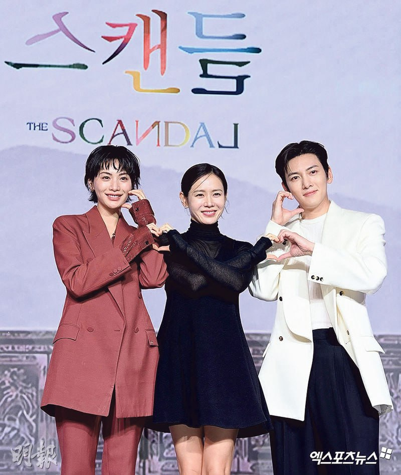

# 那个在舞台上发光的女孩，这次选择了燃烧

今天早上刚睡醒，迷迷糊糊地刷着X，然后整个人瞬间清醒了。

首页铺天盖地都是《挑情丑闻》的消息。Nana，林珍儿，全裸出镜，19禁床戏，画面冲上热搜。我盯着手机屏幕愣了好几秒，确认了一遍又一遍——是她。真的是她。

说实话，那一刻的心情很复杂。震惊是肯定的，甚至有一点"啊？真的假的"的恍惚感。但很快，那种震惊就被另一种情绪取代了——**期待**。一种很好奇的期待，想知道她到底演成什么样了，想知道这次她把自己逼到了哪一步。

## 从After School那个女孩说起

喜欢Nana这件事，仔细想想，已经很久了。

最早当然是因为After School。2009年她作为三期成员出道，那时候的Nana，是一个站在台上就会被看到的女孩。不是那种可爱型的，而是一种很利落的冷感——身材高挑，五官线条干净，表情管理精准到让人觉得她天生就该站在镜头前。后来小分队Orange Caramel，风格一下子变得有趣又鬼马，她又能把那种玩心十足的气质拿捏得很好。再后来，她在 2013 和 2014 年连续两年拿下 TC Candler "全球百大美女"第一，"世界第一美女"的标签贴在她身上，说实话，那时候很多人记住的是她的脸。

但Nana没有停在那个标签里。这一点，是我一直很喜欢她的原因。

## 她把锋芒全部收起来了

说回《挑情丑闻》。

这部剧改编自2003年的经典情色电影《丑闻：朝鲜男女相悦之事》，原作又源自法国小说《危险关系》。故事背景放在礼教森严的朝鲜时代，孙艺珍演一个心机深沉的赵氏夫人，设下一场诱惑赌局，让池昌旭演的花花公子赵元去引诱守节的寡妇——那个寡妇，就是Nana演的安熙妍。一个失去丈夫、一直恪守贞节的女子，在赵元的攻势下，压抑多年的情感最终决堤。

第7集那场长达四分钟的床戏，是全剧讨论度最高的片段。两个人全裸的状态入镜，画面尺度确实大得让人咋舌。但说实话，真正让我在意的不只是尺度本身。

有一个细节特别打动我。Nana平时的形象是什么？明艳，自信，气场全开，整个人是外放而耀眼的。但这次，她演的安熙妍，是一个在时代枷锁下把自己缩得很小很小的女人。她刻意收掉了自己所有的锋芒，体态变得更柔软，眉眼低垂，欲言又止。你看她平时的样子，再看剧里那个隐忍又不安的寡妇，会觉得这根本不是同一个人。

当然，也有观众吐槽她的混血五官跟朝鲜时代寡妇的设定有违和感，说"太出戏"。这个评论我能理解，但我也觉得，恰恰是这种"不合适"的张力，让安熙妍这个角色多了一层别的味道。一个看起来不属于那个时代的人，被那个时代困住——本身就很有故事。



## 接这个角色，本身就是一种勇气

我看到采访里说，她接这部戏很大程度上是因为信任导演郑址宇，觉得他"很细心，很理解女人"。这个理由特别Nana。她不是一个会为了话题而冒险的人，从她的作品选择里能看出来——《假面女郎》让她被更多人重新认识，那是她在演员路上真正站稳脚跟的一部戏。然后到《挑情丑闻》，她选择了一个把自己完全交出去的角色。

从爱豆到演员，这条路她走了很多年。说实话，偶像转型演员这件事，在韩娱圈里成功率并不高，太多人停留在"她以前是爱豆"的印象里。但Nana的变化是实实在在的——现在提到她，大家会先想到她演过什么角色，而不是她曾经是哪个团的成员。这个顺序的转变，她用了很久才做到。

而《挑情丑闻》里的这次表演，是她亲手把"演员Nana"这三个字又刻深了一笔。

## 尾声：继续闪耀吧，Nana

从舞台上那个光芒四射的女孩，到镜头前把自己完全交出去的演员。这条路有多难，旁人可能永远无法完全理解。但今天刷到那些消息的时候，我忽然觉得，她大概早就知道自己要往哪里走了。

期待她接下来的作品，也期待她继续走在自己选的路上。

> 진아야, 응원할게. 앞으로도 계속 빛나줘.
>
> 珍雅啊，我会继续为你应援。愿你今后也一直闪耀。